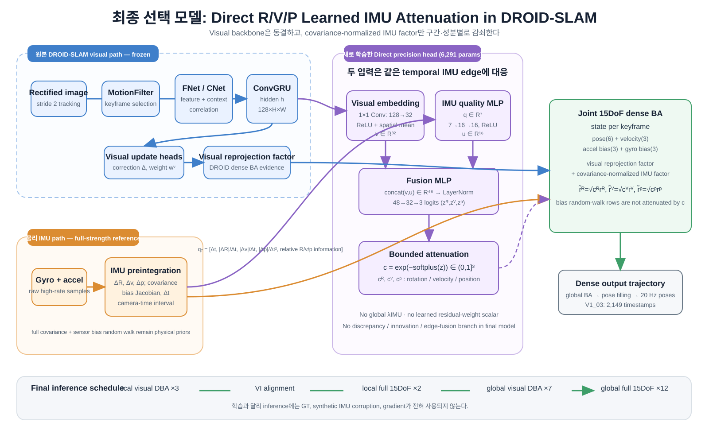

# DROID-SLAM with Direct Learned R/V/P IMU Attenuation

This repository is a focused visual–inertial extension of
[DROID-SLAM](https://arxiv.org/abs/2108.10869). It preserves the pretrained
DROID visual tracker and adds a compact learned head that decides how much to
trust the **rotation, velocity, and position** components of each IMU
preintegration factor.

The public release is centered on one final configuration:

```text
frozen DROID visual backbone
  + raw IMU preintegration and calibrated covariance
  + direct learned (c_R, c_v, c_p) in (0, 1]^3
  + two-stage 15DoF visual–inertial BA
```

`c=1` means the full covariance-normalized physical IMU factor. The network
may attenuate an unreliable temporal factor, but cannot amplify it above the
sensor-calibrated reference. There is no global learned IMU lambda in the
final model.

## Final result

On held-out EuRoC `V1_03_difficult`, using the strict original DROID EuRoC
protocol and dense whole-trajectory Sim(3) ATE:

| model | Sim(3) ATE RMSE | dense poses |
|---|---:|---:|
| Original visual DROID | 0.018560 m | 2,149 |
| Direct learned R/V/P IMU attenuation | **0.018467 m** | 2,149 |

This is a 0.093 mm / 0.501% numerical reduction on one held-out sequence and
one run. It is not presented as a statistical generalization claim. See
[results/V1_03_FINAL_RESULT.md](results/V1_03_FINAL_RESULT.md) for the exact
protocol and [FINAL_PPT_TECHNICAL_BRIEF.md](FINAL_PPT_TECHNICAL_BRIEF.md) for
the code-level architecture, training, and presentation material.

## Architecture



For a temporal keyframe edge, the direct head reads:

- the frozen DROID ConvGRU visual state, projected as `128 -> 32`;
- a 7D IMU-quality descriptor from preintegrated `dt`, `dR`, `dv`, `dp`, and
  relative R/V/P information.

It fuses `32 + 16` features and predicts three logits:

\[
c=\exp[-\operatorname{softplus}(z)] \in (0,1]^3.
\]

In 15DoF BA the state per keyframe is pose(6), velocity(3), accelerometer
bias(3), and gyroscope bias(3). The covariance-normalized residual and its
Jacobian are scaled component-wise:

\[
\tilde r_R=\sqrt{c_R}r_R,\qquad
\tilde r_v=\sqrt{c_v}r_v,\qquad
\tilde r_p=\sqrt{c_p}r_p.
\]

Bias random-walk residuals remain governed by the physical sensor model; they
are not suppressed by these three values.

## Installation

Clone recursively because the project uses `lietorch` and `pytorch_scatter`.

```bash
git clone --recursive <YOUR_REPOSITORY_URL>
cd DROID-SLAM

conda env create -f environment_novis.yaml
conda activate droid_env
pip install -r requirements.txt
pip install thirdparty/lietorch
pip install thirdparty/pytorch_scatter
pip install -e .
```

Use a PyTorch/CUDA build compatible with the local NVIDIA driver. The
evaluation uses a CUDA GPU and needs roughly 11 GB or more of VRAM.

## Weights

Two weights are required:

1. Upstream visual DROID checkpoint, `droid.pth`.
2. Final learned checkpoint,
   `learned_attenuation_rvp_quality_pretrain_joint2000_001000.pth`.

The final checkpoint is distributed as a release asset rather than committed
to source history. Its SHA-256 is recorded in
[models/FINAL_CHECKPOINT.md](models/FINAL_CHECKPOINT.md). Put both files at
any local paths and configure them through environment variables.

## Data preparation

The final protocol expects a prepared EuRoC camera directory containing
`data/`, `frames.csv`, and `imu0_sensor.yaml`, plus a rectified IMU prior and
rectified camera YAML generated from the same camera–IMU calibration.

The preparation utilities retained for this release are:

```text
tools/prepare_euroc_original_protocol_assets.py
tools/export_euroc_original_protocol_motion_filter_manifests.sh
tools/imu_preintegrate.py
```

Dataset paths are intentionally not hard-coded. Copy
`configs/final_direct_rvp.env.example` outside the repository, edit its
absolute paths, then source it:

```bash
cp configs/final_direct_rvp.env.example /tmp/final_direct_rvp.env
# Edit /tmp/final_direct_rvp.env
source /tmp/final_direct_rvp.env
```

## Reproduce the final V1_03 evaluation

```bash
source /path/to/final_direct_rvp.env
bash tools/run_final_v1_03_evaluation.sh
```

The script performs exactly three actions:

1. runs original visual DROID;
2. runs the final learned direct R/V/P 15DoF model;
3. evaluates both dense trajectories with whole-trajectory Sim(3) ATE.

It fixes the runtime schedule to:

```text
local visual DBA x3 -> local full 15DoF DBA x2
global visual DBA x7 -> global full 15DoF BA x12
```

It does **not** expose fixed-confidence, global-lambda, discrepancy,
innovation, edge-fusion, or other ablation switches.

## Train the final architecture

```bash
source /path/to/final_direct_rvp.env
bash tools/run_final_direct_rvp_train.sh
```

The script uses `MH_03_medium` and `MH_04_difficult`, freezes the original
visual DROID network and global IMU-bias parameters, then trains only the
6,291-parameter direct precision head. It has two stages:

1. 500-step IMU-quality / augmentation calibration pretraining.
2. 2,000-step joint fine-tuning with post-BA pose loss and calibration loss.

The final reported candidate is the phase-B 1k checkpoint; V1_03 must remain
held out from gradient-based training.

## Repository layout

```text
droid_slam/                         Core DROID + VI factor graph / 15DoF BA
droid_slam/geom/imu_factor.py       IMU factor, quality descriptor, covariance logic
droid_slam/geom/ba.py               R/V/P attenuation applied to residual/Jacobian
train.py                            Frozen-backbone direct-head training
demo.py                             Streaming DROID + two-stage VIO inference
tools/run_final_direct_rvp_train.sh Final training entry point
tools/run_final_v1_03_evaluation.sh Final evaluation entry point
tools/evaluate_euroc_recon.py       Dense Sim(3) evaluation
configs/                            Machine-local path template
models/                             Checkpoint distribution metadata
results/                            Small, versioned final result table
presentation_assets/                Final editable SVG diagrams
```

Intermediate logs, reconstructed trajectories, datasets, PLY files, and
experiment queues are ignored by Git. See
[GITHUB_UPLOAD_GUIDE.md](GITHUB_UPLOAD_GUIDE.md) for the explicit upload list.

## Attribution

This codebase builds on:

```bibtex
@article{teed2021droid,
  title={DROID-SLAM: Deep Visual SLAM for Monocular, Stereo, and RGB-D Cameras},
  author={Teed, Zachary and Deng, Jia},
  journal={Advances in Neural Information Processing Systems},
  year={2021}
}
```

Retain the upstream license and third-party license notices when redistributing
this repository.
